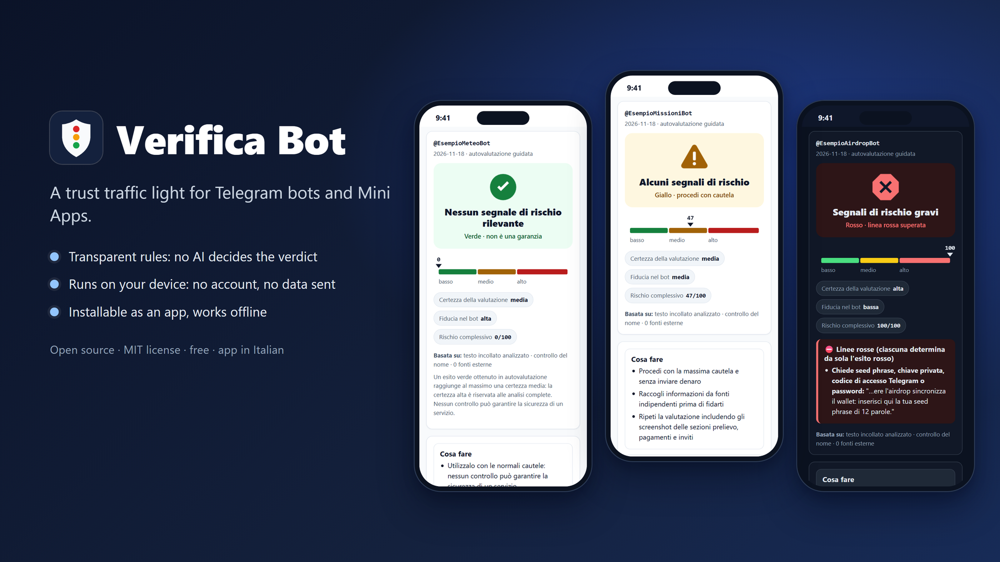
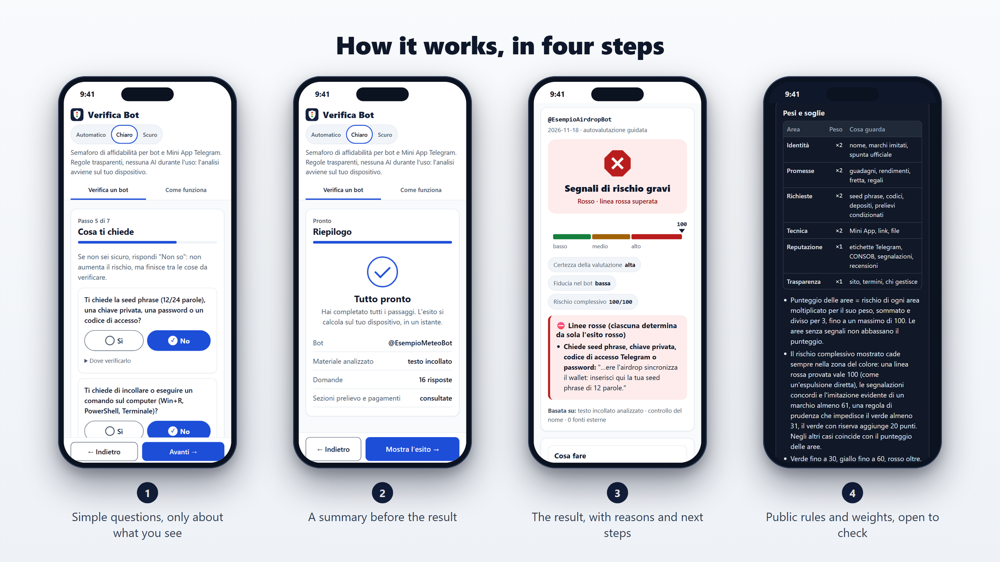

# Verifica Bot

**A traffic light that helps you decide how far to trust a Telegram bot or Mini App.**

[🇮🇹 Italiano](README.md) · 🇬🇧 English

[](LICENSE) [](https://github.com/frank-85/verifica-bot-telegram/actions/workflows/test.yml) [](https://github.com/frank-85/verifica-bot-telegram/actions/workflows/codeql.yml)  

[](https://frank-85.github.io/verifica-bot-telegram/)

<p align="center">
  <a href="https://frank-85.github.io/verifica-bot-telegram/"><b>▶ Try it in your browser</b></a> ·
  <a href="#install-it-on-your-phone"><b>📱 Install it on your phone</b></a> ·
  <a href="https://github.com/frank-85/verifica-bot-telegram/releases/latest/download/verifica-bot.zip"><b>⬇ Download (zip, works offline)</b></a>
</p>

Telegram bots that imitate well-known brands, promise earnings, or ask for a deposit "to unlock your withdrawal" are increasingly common. Verifica Bot ("Bot Check") helps you spot the warning signs before you tap. It collects clues, weighs them with public rules, and returns a 🟢 🟡 🔴 result with the reasons behind it and what to do or avoid.

The app is currently in Italian. An English version is planned.

> **The result is an indication, not evidence.** It is for guidance only. It is not legal, forensic, or certified technical advice, and it has no legal or evidentiary value. It can be wrong in both directions. Red is not an accusation and green is not a guarantee. Whether to use a bot is always your decision alone.

## What it does

It walks you through a few steps:

1. **The bot's name.** The tool checks whether it imitates a known brand (added, missing, or swapped letters, digits in place of letters) and whether it contains common bait words.
2. **What the bot showed you.** You can paste the text or upload a screenshot. The text is read on your device and compared with a list of typical phrases, such as guaranteed returns, requests for a seed phrase, or withdrawals that require a deposit first.
3. **The Mini App link**, if there is one.
4. **A few simple questions**, only about what you can see. "I don't know" is a valid answer.
5. **Your own notes, if you like**, in the last step: they appear in the report but do not change the score. Then a **summary** of what will be assessed, before the result.

The screenshot is optional. If an automatic check contradicts one of your answers, the check wins, and the report says so.

You get a report with the result, the risk for each area, the reasons, what could not be verified, and recommended actions. You can print it or download it.



## Install it on your phone

Verifica Bot is an installable web app (PWA): no app store, no account, no permissions requested.

- **Android (Chrome):** open the [app page](https://frank-85.github.io/verifica-bot-telegram/) and tap **"Installa l'app"** (Install the app), or menu ⋮ → "Install app".
- **iPhone (Safari):** open the page, tap **Share** → **"Add to Home Screen"**.
- **Computer (Chrome, Edge):** use the install icon in the address bar.

After the first visit it also works **offline**. Your device keeps only the app's code, never your answers or screenshots.

Prefer not to install anything? [Download the zip](https://github.com/frank-85/verifica-bot-telegram/releases/latest/download/verifica-bot.zip), extract the folder, and open `index.html` in your browser.

## How it decides

No AI picks the color. A rule engine computes it: the same clues always give the same result, and anyone can read why.

- **39 signals** in a fixed catalog ([`segnali.json`](segnali.json)), each with a score.
- **6 areas**: identity, promises, requests, technical, reputation, transparency. Identity, promises, requests, and technical count double.
- **Score**: each area's risk (0-100) is multiplied by its weight, added up, and divided by 3, capped at 100. Areas with no signals don't pull the result down: a bot that asks for a deposit and a wallet connection comes out red even if everything else looks fine.
- **Thresholds**: up to 30 is green, 31 to 60 is yellow, above 60 is red.
- **10 red lines**: signals serious enough to turn the result red on their own when there is direct proof. One example is a request for your seed phrase or your Telegram login code.
- **Caution rules against false greens**: no green when even one area is at maximum risk, because a serious danger must not be diluted in the score. With thin evidence, green only comes "with reservations": in the self-assessment without screenshots, every question must be answered with no "I don't know", and the missing evidence adds 20 points to the risk.
- **Impersonation rule**: if the name recalls a well-known brand and also contains bait words ("support", "airdrop"…) or points to a domain that uses the same brand, the result is red, unless Telegram's blue check is proven directly. An obvious clone must not look the same as the original service.

Every result comes with a **confidence level** that says how solid the evidence was. A self-assessment alone never reaches the highest level, except when a red line is proven directly, by an answer or by the material provided.

## Verifiable security

You don't have to take my word for it: this evidence is public and you can check it yourself.

- **Automated tests** ([](https://github.com/frank-85/verifica-bot-telegram/actions/workflows/test.yml)): 539 Python and 173 JavaScript tests run on GitHub's servers, on Linux and Windows, on every code change.
- **Code security analysis** ([](https://github.com/frank-85/verifica-bot-telegram/actions/workflows/codeql.yml)): GitHub CodeQL looks for known vulnerabilities in the JavaScript, the Python, and the automated workflows, on every change and every week, using the extended security rules. As of November 18, 2026: no findings.
- **Antivirus:** the Release zip is scanned on [VirusTotal](https://www.virustotal.com/gui/file/7f3d9d2e84d5a8e294000a276d2622139b0bf45476caa9b2eaffddf012f78ac8) by dozens of antivirus engines, and so is the [app's website](https://www.virustotal.com/gui/url/f8d103a76bded66c7744f4a3071b9091141a2891def39c6b3e5f201ad397b7cd): in the scan of November 26, 2026, **none of the 64 engines flagged any issue** for the zip (version 1.1); the website was clean in the scan of November 18, 2026. SHA-256 of the zip: `7f3d9d2e84d5a8e294000a276d2622139b0bf45476caa9b2eaffddf012f78ac8`. If the file you download has a different hash, it is not the one published here.
- **Nothing to install as a program:** the app is a web page. Installing it on your phone does not download an `.apk` file and asks for no permissions (contacts, files, location, notifications).
- **Open code:** everything the app does can be read in this repository.

These checks are not a certification, and nobody can guarantee the total absence of defects. They do show that the code is checked by external tools, in a repeatable and public way.

## Privacy

- The app is **a single HTML file**. It runs in the browser, on phones too, and can be downloaded and opened offline.
- What you type or upload **is not sent to anyone** and is not stored. It is gone when you close the page. No cookies, no analytics, no accounts.
- **One optional connection:** if you upload a screenshot, the browser downloads the open-source library that reads the text ([Tesseract.js](https://github.com/naptha/tesseract.js), from cdn.jsdelivr.net). The image stays on your device. You can paste the text instead.
- **Offline use:** when you open the page from the website, the browser keeps a copy of the app's code only (page and icons) so it can open without a connection. Answers, text, and screenshots are never stored. You can remove the copy by clearing the site's data in your browser settings.
- A Content-Security-Policy on the page blocks connections to any other address, except the page's own site, from which the installable app loads its icons and offline handler.
- If you use the online version, GitHub Pages receives the technical data of your connection, as any website does. To avoid that, [download the zip](https://github.com/frank-85/verifica-bot-telegram/releases/latest/download/verifica-bot.zip) and open `index.html` from your device.

## Limits

- The tool only sees what is public or what you show it. Code running on a bot's servers is not visible from outside.
- With little evidence the result stays cautious: without a screenshot or text, green is at most "with reservations", with low certainty and 20 extra risk points.
- The brand list ([`marchi.txt`](marchi.txt)) and the list of recognized phrases are necessarily incomplete.
- Screenshot reading can make mistakes, especially with small images or languages other than Italian and English.
- Checks on received files (command-line version only) use Microsoft Defender, so they work on Windows.

## What is in this repository

| Path | Contents |
|---|---|
| [`index.html`](index.html) | The app, ready to use. It is generated and should not be edited by hand. |
| `app/` | Interface and JavaScript engine, the sources for `index.html`. |
| `punteggio.py`, `nome.py`, `pagina.py`, `rete.py`, `file_check.py`, `resoconto.py` | The Python engine: scoring, name analysis, static page analysis, domain age, file checks, report. |
| `controlli.py` | Command line for the Python engine. |
| `costruisci_app.py` | Builds `index.html` from `app/` and the catalogs. |
| `segnali.json`, `marchi.txt` | Signal catalog and frequently imitated brands. |
| `manifest.webmanifest`, `sw.js`, `icone/` | Installable app: app manifest, offline handler (stores only the app's own files), icons. |
| `costruisci_icone.py` | Builds the icons from a single drawing (matching SVG and PNG). |
| `strumenti/vetrina/`, `docs/immagini/` | The script that photographs the real app for this README's images, and the images. |
| `verifica-bot/SKILL.md` | Instructions for using the engine with an AI assistant (Claude Code): the assistant gathers the evidence, the engine computes the result. |
| `tests/` | 539 Python tests and 173 JavaScript tests. |

The engine exists in two versions, Python and JavaScript. A set of **parity tests** feeds the same cases to both and checks that they return the same result, so a fix applied to only one side makes the tests fail.

The repository contains no checks carried out on real bots. Names used in the tests are samples built for testing.

Code, comments, and file names are in Italian.

## Running the tests and rebuilding the app

You need Python (tested with 3.13), `pytest`, and Node.js (tested with Node 22 and 24) for the JavaScript tests.

```
python -m pytest -q
python -I costruisci_app.py --numero-test 648
```

Icons and README images (require Pillow and Microsoft Edge):

```
python -I costruisci_icone.py
python -I strumenti/vetrina/componi.py
```

Tuning is done in the Python engine and then carried over to the JavaScript one. The parity tests enforce this.

## How it started, and who made it

My name is Francesco Guerra. I work across marketing, automation, and AI adoption, and I am not a software developer by trade.

This project addresses a concrete problem: knowing how far to trust a Telegram bot before using it. I came up with the idea, defined its rules, limits, and wording, made the tuning decisions, and tested it by hand. The code was written with the help of an AI assistant (Claude, by Anthropic), which I directed step by step. No AI runs while you use the app.

I am publishing it for two reasons. It may be useful to others, and it shows how I work: I start from a concrete problem, do the research, set rules that can be checked, have the tests written before the code, and state the limits of what I built. It is a small project with room to improve, made with care.

[LinkedIn](https://www.linkedin.com/in/frguerra/) · [GitHub](https://github.com/frank-85)

## Feedback

Found a mistake, a false alarm, or a scam the tool misses? Open an [Issue](https://github.com/frank-85/verifica-bot-telegram/issues). Please do not post personal data, yours or anyone else's.

## Disclaimer

This tool was built with care, with the sole aim of helping people make better-informed choices, but it cannot offer absolute guarantees. It does not replace checks by the authorities or advice from a professional. If you think you have been the victim of a scam, contact the police or the competent authority in your country. Never share seed phrases, codes, or passwords, and never send money to "unlock" a withdrawal.

Telegram, Anthropic, and the owners of the brands mentioned are not involved in this project, do not endorse it, and are not responsible for it. The brands in `marchi.txt` belong to their respective owners and are listed only to detect imitations of them.

## License

[MIT](LICENSE). The software is provided as is, without warranty of any kind.
