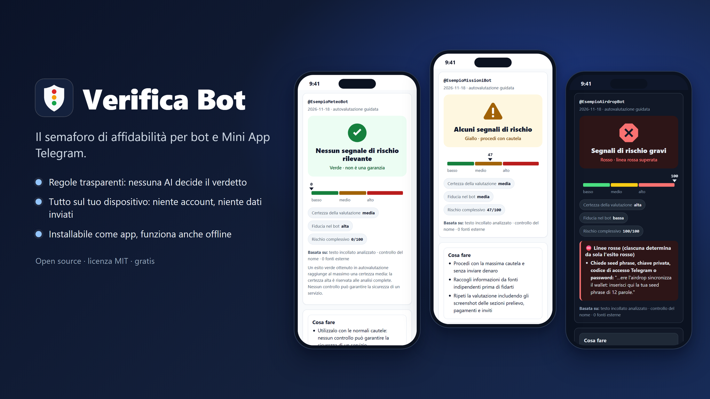
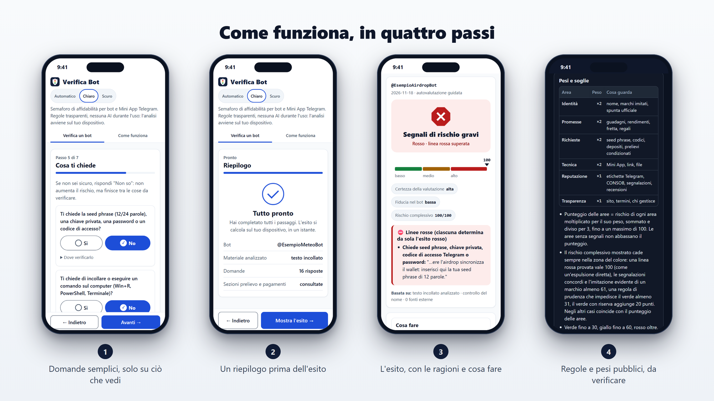

# Verifica Bot

**Un semaforo per capire quanto fidarsi di un bot o di una Mini App Telegram.**

🇮🇹 Italiano · [🇬🇧 English](README.en.md)

[](LICENSE) [](https://github.com/frank-85/verifica-bot-telegram/actions/workflows/test.yml) [](https://github.com/frank-85/verifica-bot-telegram/actions/workflows/codeql.yml)  

[](https://frank-85.github.io/verifica-bot-telegram/)

<p align="center">
  <a href="https://frank-85.github.io/verifica-bot-telegram/"><b>▶ Prova ora nel browser</b></a> ·
  <a href="#installala-sul-telefono"><b>📱 Installala sul telefono</b></a> ·
  <a href="https://github.com/frank-85/verifica-bot-telegram/releases/latest/download/verifica-bot.zip"><b>⬇ Scarica (zip, funziona offline)</b></a>
</p>

Su Telegram i bot che imitano marchi noti, promettono guadagni o chiedono un deposito «per sbloccare il prelievo» sono sempre più frequenti. Verifica Bot aiuta a riconoscerne i segnali prima di cliccare: raccoglie indizi, li pesa con regole pubbliche e restituisce un esito 🟢 🟡 🔴 con le ragioni e con cosa fare o non fare.

L'app è in italiano. Una versione inglese è in programma.

> **L'esito è un'indicazione, non una prova.** Ha valore puramente orientativo: non è un parere legale, forense o tecnico certificato e non ha valore giuridico o probatorio. Può sbagliare in entrambe le direzioni. Un rosso non è un'accusa, un verde non è una garanzia. La decisione di usare o no un bot resta sempre e soltanto di chi lo usa.

## Cosa fa

Ti guida in pochi passi:

1. **Il nome del bot.** Lo strumento controlla da sé se imita un marchio noto (lettere aggiunte, tolte o sostituite, cifre al posto di lettere) e se contiene parole usate come esca.
2. **Quello che il bot ti ha mostrato.** Puoi incollare il testo o caricare uno screenshot: il testo viene letto sul tuo dispositivo e confrontato con un elenco di frasi tipiche (rendimenti garantiti, richiesta di seed phrase, prelievo condizionato a un deposito).
3. **Il link della Mini App**, se c'è.
4. **Alcune domande semplici**, solo su ciò che vedi, a cui puoi rispondere anche «Non so».
5. **Note tue, se vuoi**, nell'ultimo passo: compaiono nel report ma non cambiano il punteggio. Poi un **riepilogo** di cosa verrà valutato, prima dell'esito.

Lo screenshot è facoltativo. Se un controllo automatico contraddice una tua risposta, prevale il controllo, e il report lo dichiara.

Alla fine ottieni un report con l'esito, il rischio per ciascuna area, i motivi, cosa non è stato possibile verificare e i comportamenti consigliati. Puoi stamparlo o scaricarlo.



## Installala sul telefono

Verifica Bot è un'app web installabile (PWA): niente store, niente account, nessun permesso richiesto.

- **Android (Chrome):** apri la [pagina dell'app](https://frank-85.github.io/verifica-bot-telegram/) e tocca **«Installa l'app»**, oppure menu ⋮ → «Installa app».
- **iPhone (Safari):** apri la pagina, tocca **Condividi** → **«Aggiungi alla schermata Home»**.
- **Computer (Chrome, Edge):** usa l'icona di installazione nella barra degli indirizzi.

Dopo la prima apertura funziona anche **offline**. Il dispositivo conserva solo il codice dell'app, mai le tue risposte o i tuoi screenshot.

Preferisci non installare nulla? [Scarica lo zip](https://github.com/frank-85/verifica-bot-telegram/releases/latest/download/verifica-bot.zip), estrai la cartella e apri `index.html` nel browser.

## Come decide

Il colore non lo sceglie un'intelligenza artificiale. Lo calcola un motore a regole: a parità di indizi, l'esito è sempre lo stesso, e chiunque può leggere perché.

- **39 segnali** in un catalogo fisso ([`segnali.json`](segnali.json)), ciascuno con un punteggio.
- **6 aree**: identità, promesse, richieste, tecnica, reputazione, trasparenza. Identità, promesse, richieste e tecnica pesano il doppio.
- **Punteggio**: il rischio di ogni area (0-100) si moltiplica per il suo peso, si somma e si divide per 3, fino a un massimo di 100. Le aree senza segnali non abbassano il risultato: un bot che chiede un deposito e il collegamento del wallet risulta rosso anche se il resto sembra in ordine.
- **Soglie**: fino a 30 verde, da 31 a 60 giallo, oltre 60 rosso.
- **10 linee rosse**: segnali così gravi che, se provati direttamente, portano al rosso da soli. Per esempio la richiesta della seed phrase o del codice di accesso a Telegram.
- **Regole di prudenza contro i falsi verdi**: niente verde se anche una sola area è al massimo del rischio, perché un pericolo grave non deve diluirsi nel punteggio. Con prove scarse il verde arriva solo "con riserva": nell'autovalutazione senza screenshot serve aver risposto a tutto senza "Non so", e la prova mancante aggiunge 20 punti al rischio.
- **Regola sull'imitazione**: se il nome richiama un marchio noto e contiene anche parole esca ("support", "airdrop"…) o rimanda a un dominio che usa lo stesso marchio, l'esito è rosso, salvo spunta blu di Telegram provata direttamente. Un clone evidente non deve risultare uguale al servizio originale.

Ogni esito è accompagnato dalla **certezza della valutazione**, che dice quanto erano solide le prove. Con la sola autovalutazione la certezza non arriva mai al livello più alto, salvo quando una linea rossa è provata direttamente, da una risposta o dal materiale fornito.

## Sicurezza verificabile

Non devi fidarti sulla parola: queste prove sono pubbliche e puoi controllarle tu.

- **Test automatici** ([](https://github.com/frank-85/verifica-bot-telegram/actions/workflows/test.yml)): 539 test Python e 173 JavaScript girano sui server di GitHub, su Linux e Windows, a ogni modifica del codice.
- **Analisi di sicurezza del codice** ([](https://github.com/frank-85/verifica-bot-telegram/actions/workflows/codeql.yml)): GitHub CodeQL cerca falle note nel JavaScript, nel Python e nei flussi automatici, a ogni modifica e ogni settimana, con le regole di sicurezza estese. Al 18/11/2026: nessuna segnalazione.
- **Antivirus:** lo zip della Release è analizzato su [VirusTotal](https://www.virustotal.com/gui/file/7f3d9d2e84d5a8e294000a276d2622139b0bf45476caa9b2eaffddf012f78ac8) da decine di motori antivirus, e lo stesso vale per il [sito dell'app](https://www.virustotal.com/gui/url/f8d103a76bded66c7744f4a3071b9091141a2891def39c6b3e5f201ad397b7cd): all'analisi del 26/11/2026 **nessuno dei 64 motori ha segnalato problemi** per lo zip (versione 1.1), e lo stesso giorno **nessuno dei 93 motori ha segnalato problemi** per il sito. Impronta SHA-256 dello zip: `7f3d9d2e84d5a8e294000a276d2622139b0bf45476caa9b2eaffddf012f78ac8`. Se l'impronta del file che scarichi è diversa, non è quello pubblicato qui.
- **Nessun programma da installare:** l'app è una pagina web. Installarla sul telefono non scarica un file `.apk` e non chiede permessi (contatti, file, posizione, notifiche).
- **Codice aperto:** tutto ciò che fa l'app è leggibile in questo repository.

Queste verifiche non sono una certificazione e nessuno può garantire l'assenza assoluta di difetti. Dimostrano però che il codice è controllato da strumenti esterni, in modo ripetibile e pubblico.

## Privacy

- L'app è **un unico file HTML**. Funziona nel browser, anche da telefono, e si può scaricare e aprire senza connessione.
- **Uso offline:** quando apri la pagina dal sito, il browser conserva una copia del solo codice dell'app (pagina e icone) per aprirla anche senza connessione. Risposte, testi e screenshot non vengono mai conservati. La copia si elimina cancellando i dati del sito dalle impostazioni del browser.
- Quello che scrivi o carichi **non viene inviato a nessuno** e non viene salvato: sparisce quando chiudi la pagina. Niente cookie, niente statistiche, niente account.
- **Unica connessione facoltativa:** se carichi uno screenshot, il browser scarica la libreria open source che legge il testo ([Tesseract.js](https://github.com/naptha/tesseract.js), da cdn.jsdelivr.net). L'immagine resta sul tuo dispositivo. Se preferisci, incolla il testo.
- Una regola di sicurezza della pagina (Content-Security-Policy) blocca le connessioni verso qualsiasi altro indirizzo, salvo la pagina stessa, da cui l'app installabile carica icone e gestore offline.
- Se usi la versione online, GitHub Pages riceve i dati tecnici della connessione, come ogni sito web. Per evitarlo, [scarica lo zip](https://github.com/frank-85/verifica-bot-telegram/releases/latest/download/verifica-bot.zip) e apri `index.html` dal tuo dispositivo.

## Limiti

- Lo strumento vede solo ciò che è pubblico o che gli mostri tu. Il codice che gira sui server di un bot non è visibile a nessuno dall'esterno.
- Con poche prove l'esito resta prudente: senza screenshot o testo il verde è al massimo «con riserva», con certezza bassa e 20 punti di rischio in più.
- L'elenco dei marchi ([`marchi.txt`](marchi.txt)) e quello delle frasi riconosciute sono per forza incompleti.
- La lettura degli screenshot può sbagliare, soprattutto con immagini piccole o testi in lingue diverse da italiano e inglese.
- I controlli sui file ricevuti (solo nella versione da riga di comando) usano Microsoft Defender e funzionano quindi su Windows.

## Cosa c'è nel repository

| Percorso | Contenuto |
|---|---|
| [`index.html`](index.html) | L'app, pronta all'uso. È generata: non si modifica a mano. |
| `app/` | Interfaccia e motore JavaScript, da cui nasce `index.html`. |
| `punteggio.py`, `nome.py`, `pagina.py`, `rete.py`, `file_check.py`, `resoconto.py` | Il motore Python: calcolo dell'esito, analisi del nome, analisi statica delle pagine, età dei domini, controllo dei file, report. |
| `controlli.py` | Riga di comando del motore Python. |
| `costruisci_app.py` | Assembla `index.html` a partire da `app/` e dai cataloghi. |
| `segnali.json`, `marchi.txt` | Catalogo dei segnali e marchi spesso imitati. |
| `manifest.webmanifest`, `sw.js`, `icone/` | App installabile: scheda dell'app, gestore offline (salva solo i file dell'app), icone. |
| `costruisci_icone.py` | Genera le icone da un unico disegno (SVG e PNG coerenti). |
| `strumenti/vetrina/`, `docs/immagini/` | Lo script che fotografa l'app vera per le immagini di questo README, e le immagini. |
| `verifica-bot/SKILL.md` | Le istruzioni per usare il motore con un assistente AI (Claude Code): l'assistente raccoglie le prove, il motore calcola l'esito. |
| `tests/` | 539 test Python e 173 test JavaScript. |

Il motore esiste in due versioni, Python e JavaScript. Una serie di **test di parità** dà gli stessi casi a entrambe e verifica che producano lo stesso risultato: una correzione fatta da una parte sola fa fallire i test.

Nel repository non ci sono verifiche svolte su bot reali: i nomi usati nei test sono campioni costruiti per le prove.

## Eseguire i test e rigenerare l'app

Servono Python (provato con 3.13), `pytest` e Node.js (provato con Node 22 e 24) per i test della parte JavaScript.

```
python -m pytest -q
python -I costruisci_app.py --numero-test 648
```

Icone e immagini del README (servono Pillow e Microsoft Edge):

```
python -I costruisci_icone.py
python -I strumenti/vetrina/componi.py
```

Le tarature si fanno nel motore Python e si riportano in quello JavaScript: i test di parità lo impongono.

## Come è nato, e chi l'ha fatto

Mi chiamo Francesco Guerra. Lavoro tra marketing, automazione e adozione dell'intelligenza artificiale, e non sono uno sviluppatore di professione.

Questo progetto risponde a un problema concreto: capire quanto fidarsi di un bot Telegram prima di usarlo. L'ho ideato, ne ho definito regole, limiti e parole, ho preso le decisioni di taratura e l'ho collaudato a mano. Il codice è stato scritto con l'assistenza di un'intelligenza artificiale (Claude, di Anthropic), che ho diretto passo dopo passo. Durante l'uso dell'app, invece, non interviene alcuna AI.

Lo pubblico per due ragioni: può essere utile ad altri, e mostra il modo in cui lavoro. Parto da un problema concreto, mi documento, fisso regole verificabili, faccio scrivere i test prima del codice e dichiaro i limiti di ciò che ho costruito. È un progetto piccolo e migliorabile, fatto con cura.

[LinkedIn](https://www.linkedin.com/in/frguerra/) · [GitHub](https://github.com/frank-85)

## Segnalazioni

Hai trovato un errore, un falso allarme o una truffa che lo strumento non riconosce? Apri una [Issue](https://github.com/frank-85/verifica-bot-telegram/issues). Per favore non pubblicare dati personali, tuoi o di altri.

## Avvertenze

Questo strumento è stato realizzato con cura, con il solo scopo di aiutare chi lo usa a orientarsi, ma non può offrire garanzie assolute. Non sostituisce le verifiche delle autorità né il parere di un professionista. Se pensi di essere stato vittima di una truffa, rivolgiti alla polizia o all'autorità competente del tuo paese. Non condividere mai seed phrase, codici o password, e non inviare denaro per «sbloccare» un prelievo.

Telegram, Anthropic e i titolari dei marchi citati non sono coinvolti nel progetto, non lo approvano e non ne sono responsabili. I marchi presenti in `marchi.txt` appartengono ai rispettivi titolari e sono elencati al solo scopo di riconoscerne le imitazioni.

## Licenza

[MIT](LICENSE). Il software è fornito così com'è, senza garanzie di alcun tipo.
